# cs-paper-table

An agent skill for designing, repairing and typesetting tables for computer-science research papers: benchmark and leaderboard tables, ablations, efficiency comparisons, dataset registers and capability matrices. It turns a typed JSON spec into editable LaTeX, a vector PDF, a PNG preview, semantic HTML and CSV, and it is built from a close study of how tables are typeset in leading AI research papers.

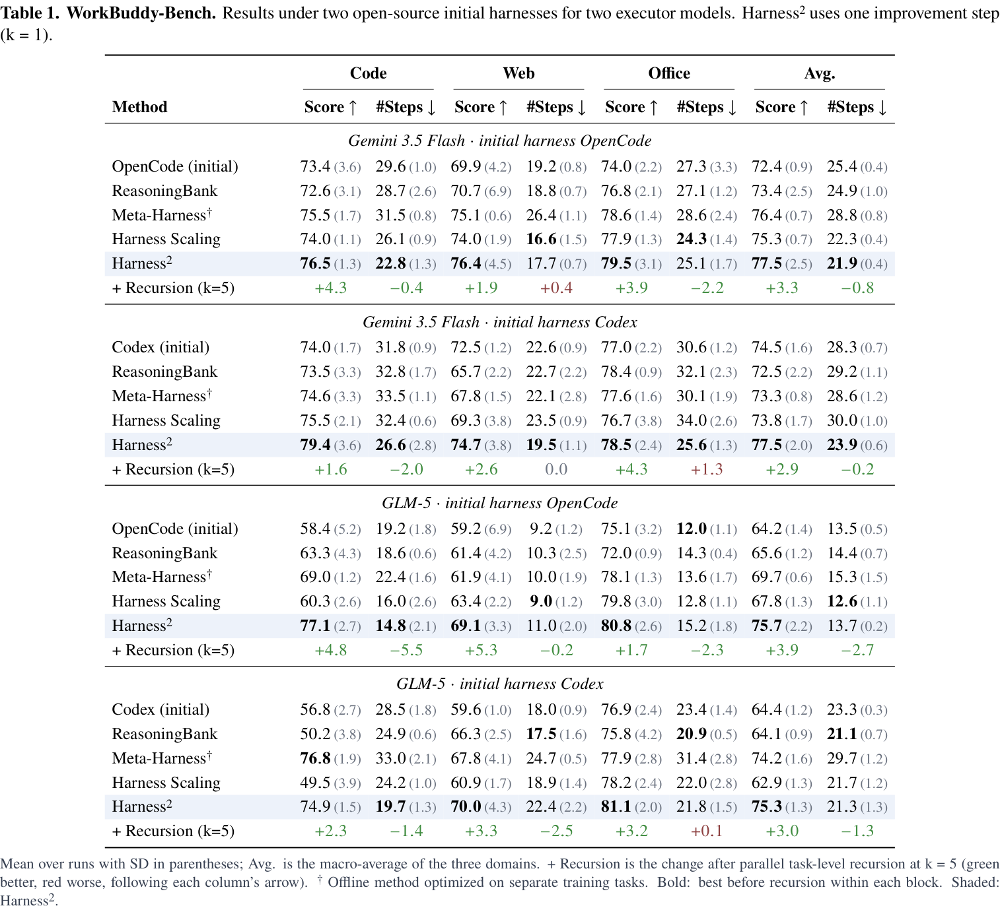

<sub>Harness² Table 1, rebuilt with this skill from the values in the paper. See the [comparison with the original](#redesigning-real-tables).</sub>

## What is inside

| Part | Purpose |
| --- | --- |
| [`SKILL.md`](skills/cs-paper-table/SKILL.md) | The workflow: table contract → structure → design at final size → editable output → verification |
| [`table-craft.md`](skills/cs-paper-table/references/table-craft.md) | How it should look: a 17-paper visual study, 22 rules with LaTeX hints, the renderer's defaults and a redesign protocol |
| [`render_table.py`](skills/cs-paper-table/scripts/render_table.py) | Typed spec → LaTeX / PDF / PNG / HTML / CSV, with scoped bold and underline, decimal alignment, ± or (SD), ✓/✗, direction-aware delta rows, spanning cells, `a·10ⁿ`, thousands separators and automated export checks |
| [`scientific-contract.md`](skills/cs-paper-table/references/scientific-contract.md), [`spec-schema.md`](skills/cs-paper-table/references/spec-schema.md) | What a table may claim: comparison scopes, uncertainty types, typed missing values, provenance |
| `references/evidence*`, `*.csv` | A 54-paper / 95-table evidence corpus with measured fonts, rules and colours |

## Gallery

### Redesigning real tables

Every value, row and column comes from the paper; only the typesetting changes.

#### The Transformer, Table 2 ([arXiv:1706.03762](https://arxiv.org/abs/1706.03762))

| Original (Vaswani et al., 2017) | Redesigned with this skill |
| --- | --- |
| 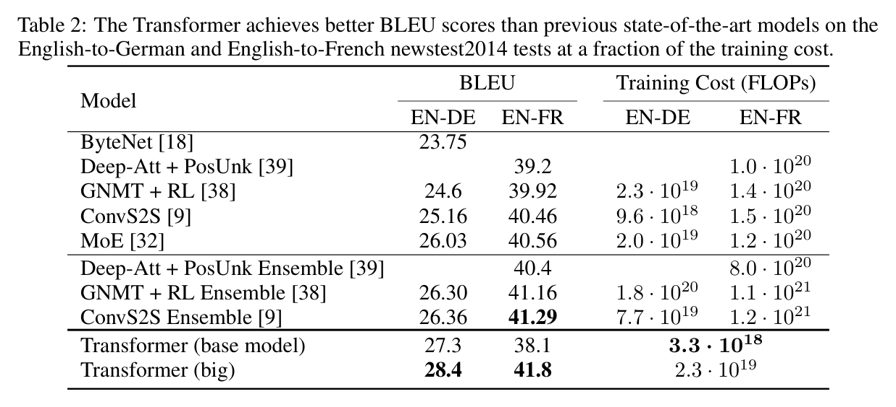 | 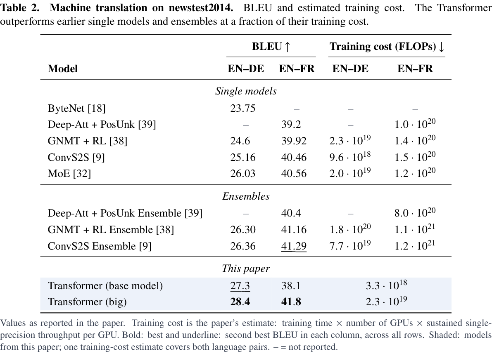 |

- Rows are grouped and labelled (single models, ensembles, this paper) instead of separated by unlabelled rules.
- Empty cells become "–" with a legend; the metric direction (BLEU ↑, cost ↓) is in the header.
- Bold is the best BLEU and underline the second best in each column, stated in the notes; the original bolded 41.29 and 41.8 in the same column.
- The paper's own models are shaded; the shared cost estimate spans both language pairs.

[PDF](gallery/redesign/transformer_t2.pdf) · [spec](skills/cs-paper-table/assets/specs/redesigns/transformer_t2.json)

#### Harness², Table 1 ([arXiv:2610.14224](https://arxiv.org/abs/2610.14224))

| Original (Harness² paper) | Redesigned with this skill |
| --- | --- |
| 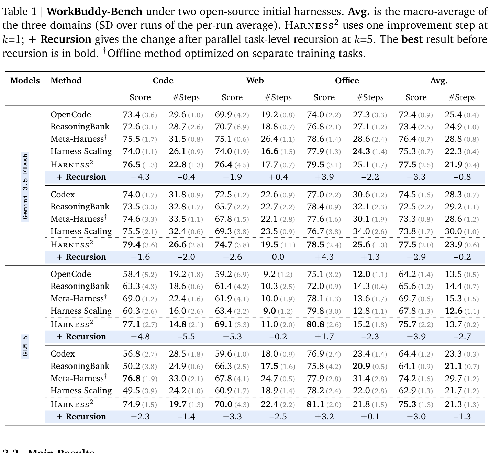 |  |

- The rotated monospace model labels become banner rows naming the model and the initial harness.
- Score ↑ and #Steps ↓ carry their direction, so bold works for both.
- The "+ Recursion" changes are coloured by improvement after each column's direction: a step reduction (−2.0) is green, a step increase (+1.3) red.
- SDs stay as small grey (SD); the caption shrinks to two sentences and the definitions move to the notes.

[PDF](gallery/redesign/harness2_t1.pdf) · [spec](skills/cs-paper-table/assets/specs/redesigns/harness2_t1.json)

#### ReHarness, Table 1 ([arXiv:2610.12668](https://arxiv.org/abs/2610.12668))

| Original (ReHarness paper) | Redesigned with this skill |
| --- | --- |
| 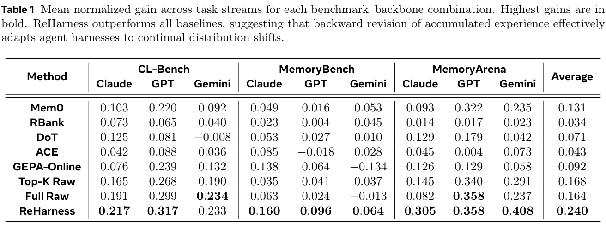 | 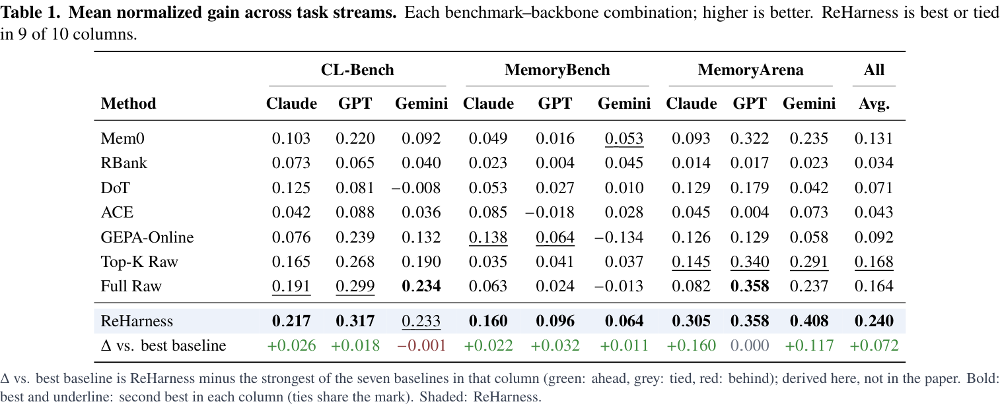 |

Underline for second best, the method row shaded and set apart, and a derived "Δ vs. best baseline" row (green ahead, grey tied, red behind) so the margin is read, not computed; the doubled midrule and vertical rules are gone. [PDF](gallery/redesign/reharness_t1.pdf) · [spec](skills/cs-paper-table/assets/specs/redesigns/reharness_t1.json)

#### PaperBanana, Table 2 ([arXiv:2601.23265](https://arxiv.org/abs/2601.23265))

| Original (PaperBanana paper) | Redesigned with this skill |
| --- | --- |
| 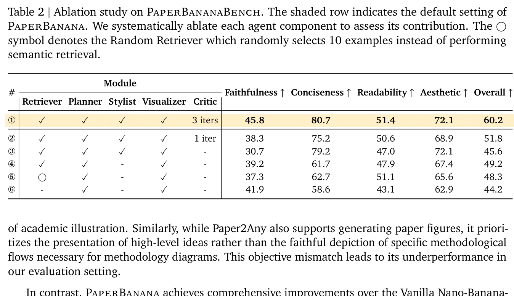 | 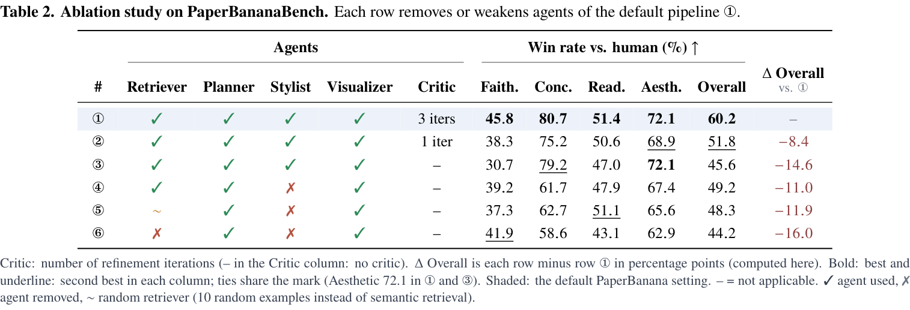 |

Coloured ✓/✗ with a legend that defines the random retriever, an "Agents" spanner instead of vertical rules, bold and underline per column with the Aesthetic tie stated, and a "Δ Overall vs. ①" column coloured by improvement. [PDF](gallery/redesign/paperbanana_t2.pdf) · [spec](skills/cs-paper-table/assets/specs/redesigns/paperbanana_t2.json)

### Five examples: before → after

Synthetic data for illustration.

| | Before | After |
| --- | --- | --- |
| **Benchmark**: two budgets, quality and cost | 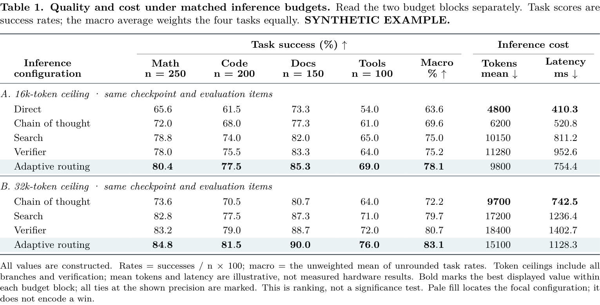 | 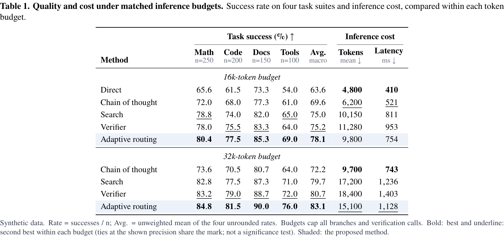 |
| **Ablation**: components, SD and paired CIs | 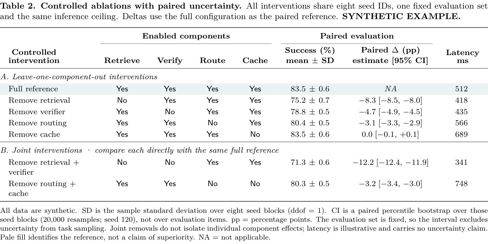 | 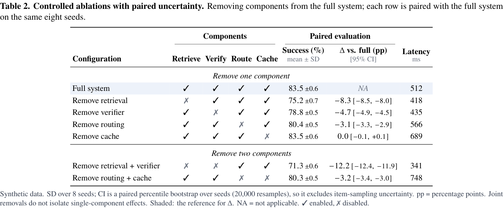 |
| **Efficiency**: metrics as rows, OOM | 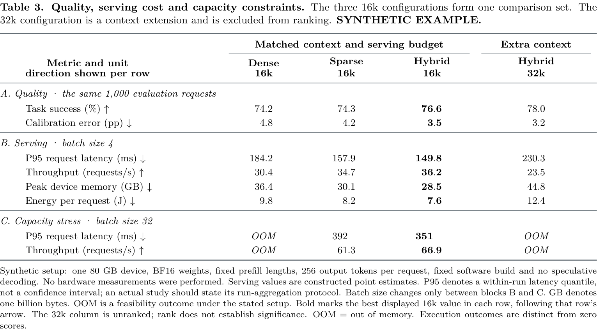 | 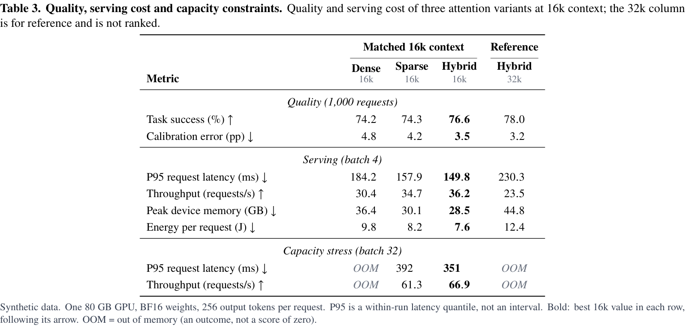 |
| **Registry**: text, counts, NA/NR | 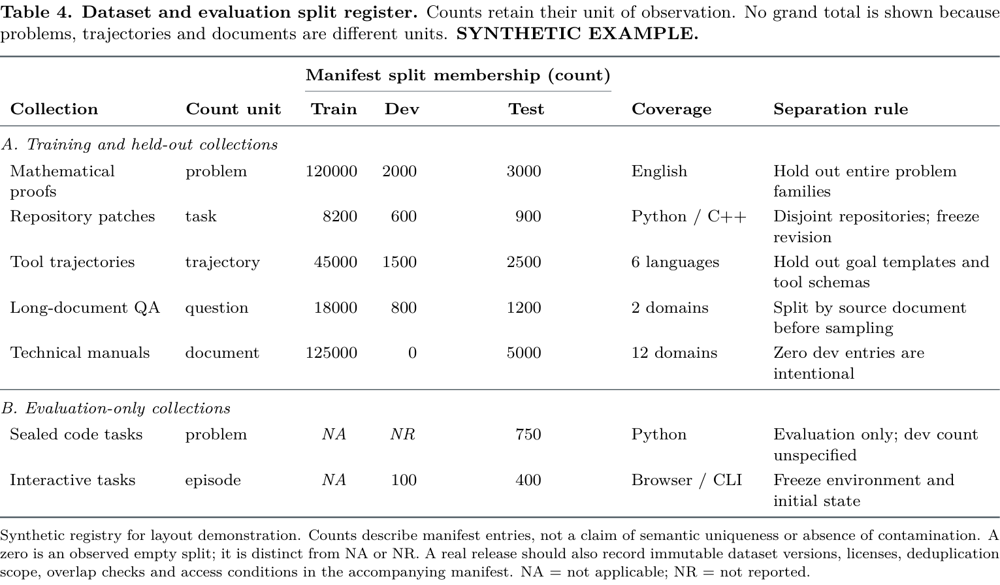 | 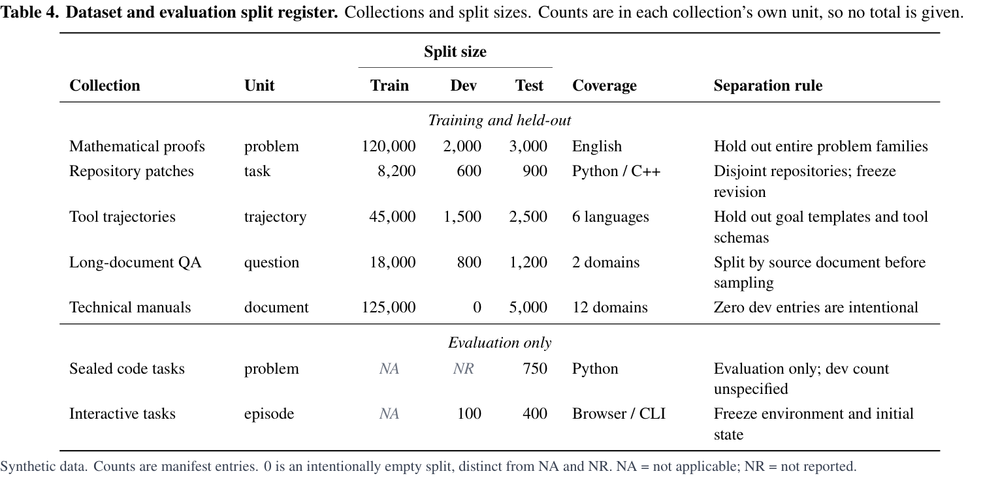 |
| **Single column**: 88 mm | 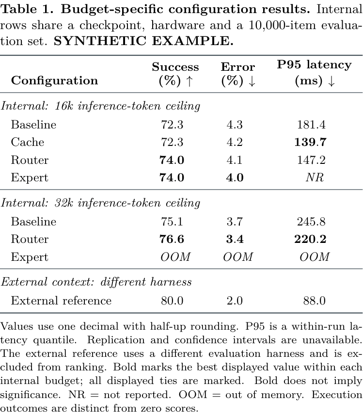 | 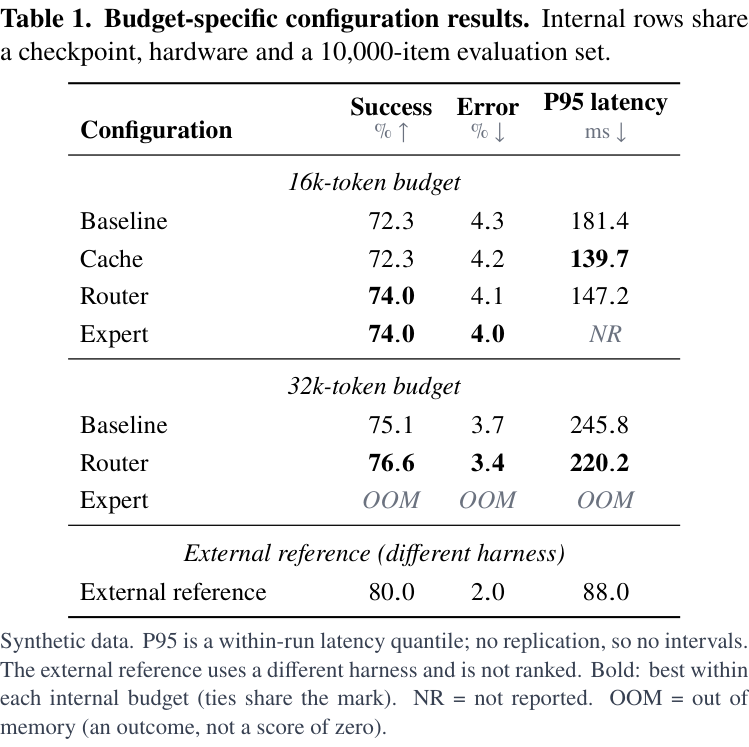 |

What changed: Times instead of Latin Modern, bold names over small muted units, centred italic group banners, ✓/✗ instead of Yes/No, `120,000` instead of `120000`, smaller ± and intervals, an optional underline for second best, and captions and notes cut from six lines to two or three.

### Capability matrix

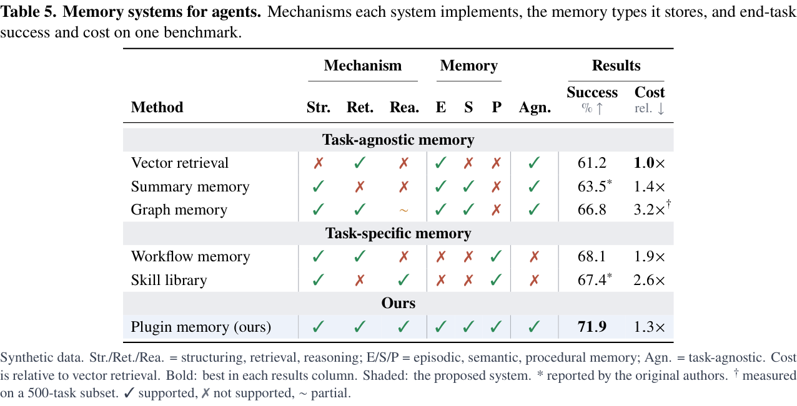

Grey category bands instead of rules, hairlines only between column groups, coloured ✓/✗ with the glyph shape still distinct, `1.0×` relative cost, and `*` / `†` cell marks defined once in the notes, following the PlugMem and StudentSim tables (synthetic data). [PDF](gallery/after/capability.pdf) · [spec](skills/cs-paper-table/assets/specs/capability.json)

## What the study found

The skill's [table-craft.md](skills/cs-paper-table/references/table-craft.md) records the typeset tables of DeepSeek-V3, Qwen2.5, Llama 3, LLaMA, Gemini 1.5, GPT-4, Phi-4, Nemotron-4 340B, DINOv2, Hunyuan-Large, Kimi k1.5/K2 and the Transformer, with fonts, rules and colours measured from the PDFs. The short version:

- **Restraint is the style.** 8 of 13 papers use no colour in result tables; text is black; booktabs rules with no vertical lines.
- **Hierarchy comes from type, not lines**: bold names with a small second line for n, unit or shots; spanners with trimmed `\cmidrule`s; centred banners for row groups.
- **One emphasis, defined**: bold = best within a stated scope, ties all bold; underline only with a legend.
- **Secondary numbers recede**: ± and SDs smaller and muted; deltas small and muted green/red (`#408C40` / `#8C4040`, DINOv2).
- **Short captions**: a bold title and one or two sentences.
- **Failures to avoid**: `\resizebox` down to 6.9 pt, rotated headers, link-blue emphasis, per-row hairlines, mixed "46%"/"46.2".

## Installation

```bash
# 1. Skills CLI (Claude Code, Codex and other agents)
npx skills@latest add zichuanxu/cs-paper-table-skill

# 2. Claude Code plugin
claude plugin marketplace add zichuanxu/cs-paper-table-skill
claude plugin install cs-paper-table@cs-paper-table-skill

# 3. Codex plugin
codex plugin marketplace add zichuanxu/cs-paper-table-skill
codex plugin add cs-paper-table@cs-paper-table-skill
```

Or copy `skills/cs-paper-table` into `~/.claude/skills/`. The renderer needs Python ≥ 3.10 with `pymupdf` (and `numpy` for the example builder) and a TeX distribution with `pdflatex`, `newtx`, `booktabs`, `dcolumn`, `pifont` and `xcolor`.

## Usage

Ask your agent in plain language, for example "Make the main results table from results.csv for a two-column paper", "Redesign Table 3 of this paper" or "Turn this ablation into a table with SDs and deltas".

To render the examples yourself:

```bash
cd skills/cs-paper-table/scripts
python render_table.py ../assets/specs/redesigns/harness2_t1.json --out /tmp/h2
python build_examples.py --out /tmp/examples --render
```

Each table comes out as `.tex`, `_body.tex` (drop into your `table` float), `_caption.tex`, PDF, PNG (216 dpi, 96 dpi and greyscale), HTML, CSV, the typed spec, an emphasis audit and automated checks.

## License

[MIT](LICENSE), except the original table crops in `gallery/redesign/original/`: the Transformer table is reproduced under Google's permission to reproduce tables and figures of *Attention Is All You Need* for scholarly works with attribution (Vaswani et al., NeurIPS 2017); the Harness² and PaperBanana tables are © their authors under [CC BY 4.0](https://creativecommons.org/licenses/by/4.0/); the ReHarness table is © its authors, reproduced for commentary and comparison and removed on request. The redesigns are independent demonstrations, not affiliated with those papers' authors.
