# cs-paper-table

An agent skill for designing, repairing and typesetting tables for computer-science research papers: benchmark and leaderboard tables, ablations, efficiency comparisons, dataset registers and capability matrices. It turns a typed JSON spec into editable LaTeX, a vector PDF, a PNG preview, semantic HTML and CSV, and it is built from a close study of how tables are typeset in AI-lab reports and in 2025–2026 award papers across machine learning, vision, NLP, systems, security, databases and HCI.

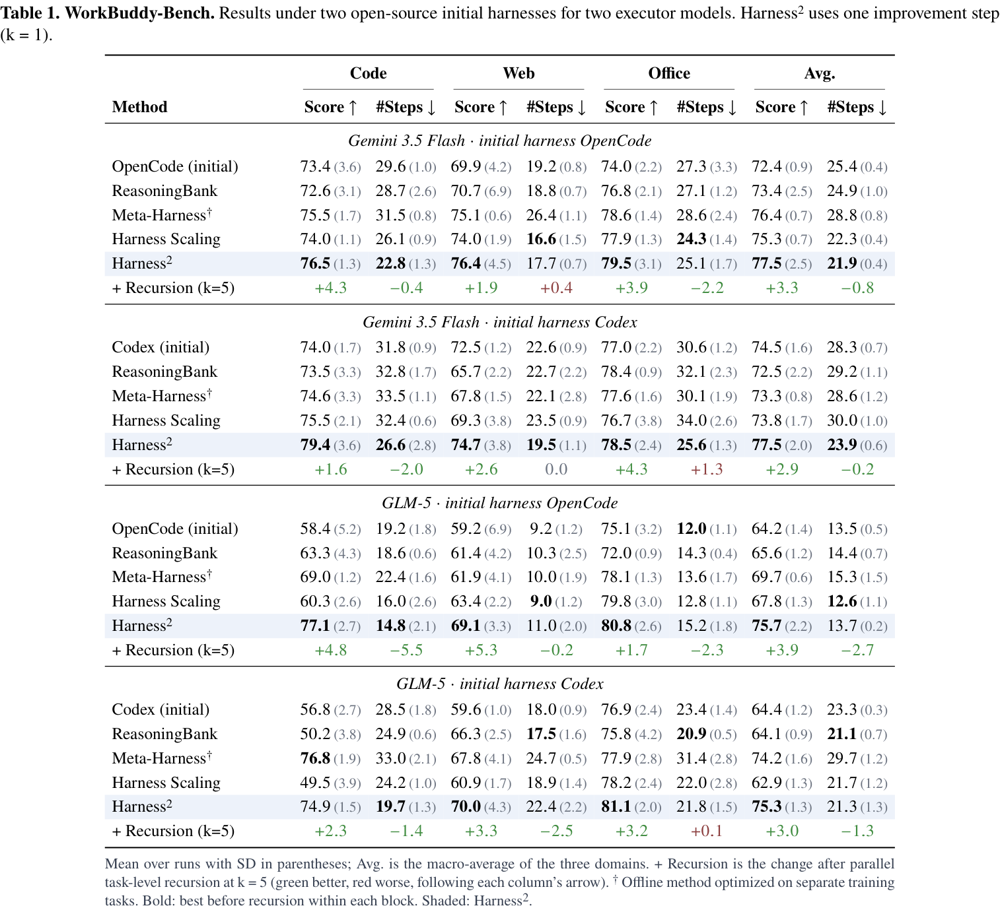

<sub>Harness² Table 1, rebuilt with this skill from the values in the paper. See the [comparison with the original](#redesigning-real-tables).</sub>

## What is inside

| Part | Purpose |
| --- | --- |
| [`SKILL.md`](skills/cs-paper-table/SKILL.md) | Eight principles and the workflow: table contract → structure → editable output → verification |
| [`table-craft.md`](skills/cs-paper-table/references/table-craft.md) | How it should look: the principles, the rules that follow from them with their renderer fields, community conventions, the defects award papers still ship, a redesign protocol and a five-second review |
| [`craft-study.md`](skills/cs-paper-table/references/craft-study.md) | The evidence: what each of 50 papers (about 190 tables) does well and badly, with measured sizes, rules and colours |
| [`render_table.py`](skills/cs-paper-table/scripts/render_table.py) | Typed spec → LaTeX / PDF / PNG / HTML / CSV, with scoped bold and underline, optional rank tints, decimal alignment, ± or (SD), ✓/✗ or ●/◐/○, direction-aware delta rows, heat shading on a declared scale or by the drop from a reference column, count/share cells, censored values (`> 180`), spanning cells, `a·10ⁿ`, thousands separators and automated export checks |
| [`scientific-contract.md`](skills/cs-paper-table/references/scientific-contract.md), [`spec-schema.md`](skills/cs-paper-table/references/spec-schema.md) | What a table may claim: comparison scopes, uncertainty types, typed missing values, provenance |
| `references/evidence*`, `*.csv` | A 54-paper / 95-table evidence corpus with measured fonts, rules and colours |

## Gallery

### Redesigning real tables

Every value, row and column comes from the paper; only the typesetting changes.

#### The Transformer, Table 2 ([arXiv:1706.03762](https://arxiv.org/abs/1706.03762))

| Original (Vaswani et al., 2017) | Redesigned with this skill |
| --- | --- |
| 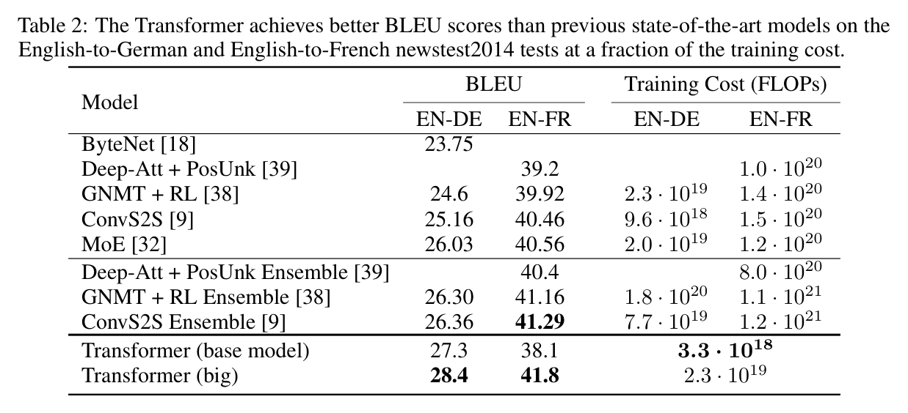 | 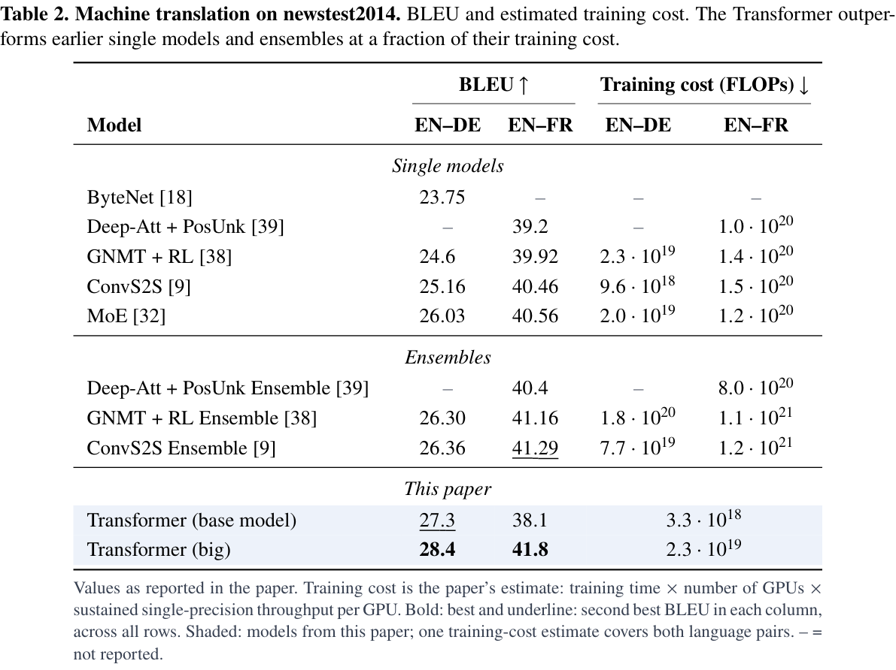 |

- Rows are grouped and labelled (single models, ensembles, this paper) instead of separated by unlabelled rules.
- Empty cells become "–" with a legend; the metric direction (BLEU ↑, cost ↓) is in the header.
- Bold is the best BLEU and underline the second best in each column, stated in the notes; the original bolded 41.29 and 41.8 in the same column.
- The paper's own models are shaded; the shared cost estimate spans both language pairs.

[PDF](gallery/redesign/transformer_t2.pdf) · [spec](skills/cs-paper-table/assets/specs/redesigns/transformer_t2.json)

#### Harness², Table 1 ([arXiv:2610.14224](https://arxiv.org/abs/2610.14224))

| Original (Harness² paper) | Redesigned with this skill |
| --- | --- |
| 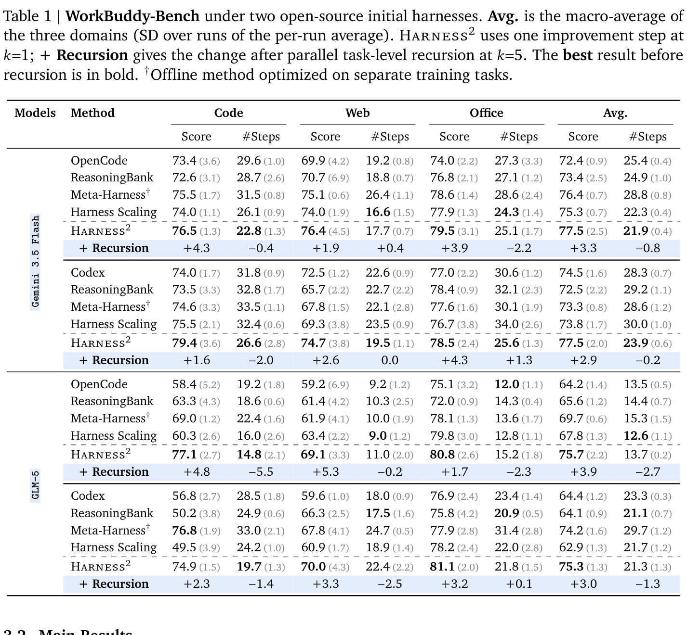 |  |

- The rotated monospace model labels become banner rows naming the model and the initial harness.
- Score ↑ and #Steps ↓ carry their direction, so bold works for both.
- The "+ Recursion" changes are coloured by improvement after each column's direction: a step reduction (−2.0) is green, a step increase (+1.3) red.
- SDs stay as small grey (SD); the caption shrinks to two sentences, the second stating what the table shows, and the definitions move to the notes.

[PDF](gallery/redesign/harness2_t1.pdf) · [spec](skills/cs-paper-table/assets/specs/redesigns/harness2_t1.json)

#### ReHarness, Table 1 ([arXiv:2610.12668](https://arxiv.org/abs/2610.12668))

| Original (ReHarness paper) | Redesigned with this skill |
| --- | --- |
| 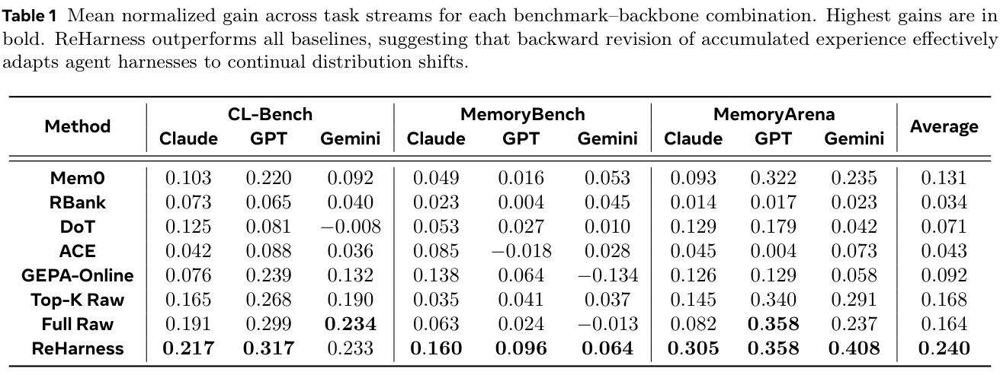 | 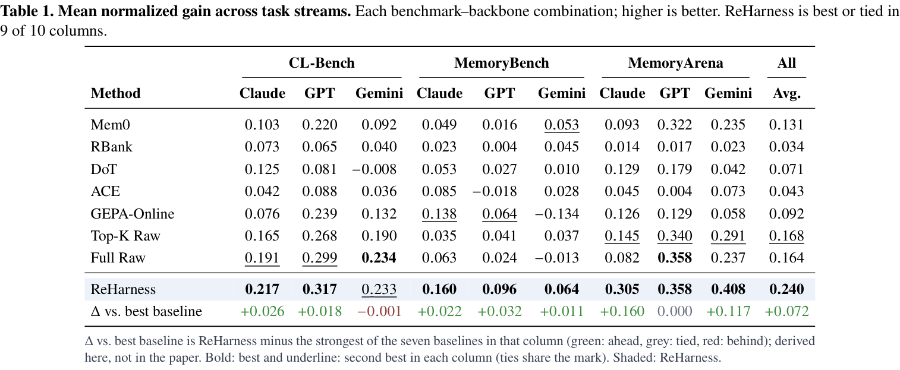 |

Underline for second best, the method row shaded and set apart, and a derived "Δ vs. best baseline" row (green ahead, grey tied, red behind) so the margin is read, not computed; the doubled midrule and vertical rules are gone. [PDF](gallery/redesign/reharness_t1.pdf) · [spec](skills/cs-paper-table/assets/specs/redesigns/reharness_t1.json)

#### PaperBanana, Table 2 ([arXiv:2601.23265](https://arxiv.org/abs/2601.23265))

| Original (PaperBanana paper) | Redesigned with this skill |
| --- | --- |
| 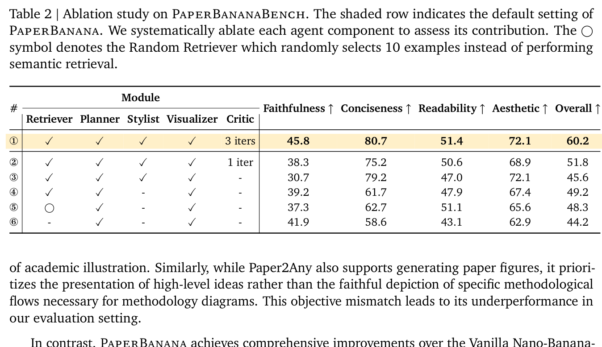 | 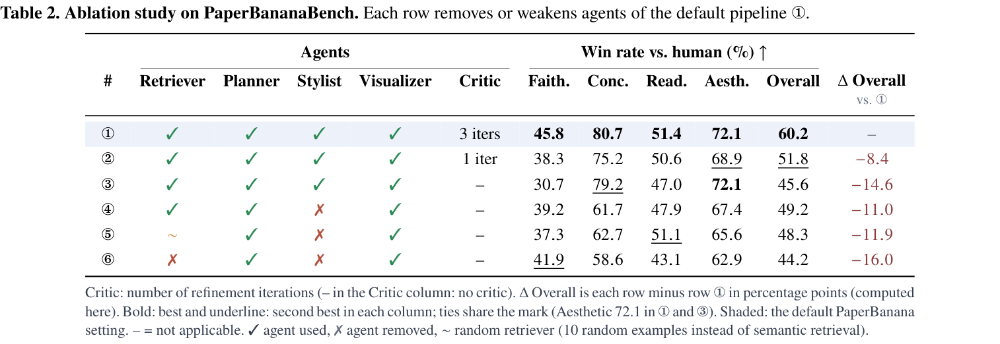 |

Coloured ✓/✗ with a legend that defines the random retriever, an "Agents" spanner instead of vertical rules, bold and underline per column with ties sharing the mark, and a "Δ Overall" column coloured by improvement. A missing critic reads "none", so the dash keeps a single meaning, and the caption ends with the finding (every change costs 8.4 to 16.0 points). [PDF](gallery/redesign/paperbanana_t2.pdf) · [spec](skills/cs-paper-table/assets/specs/redesigns/paperbanana_t2.json)

#### ARE-bench, Table 6 ([arXiv:2611.14364](https://arxiv.org/abs/2611.14364))

| Original (ARE-bench paper) | Redesigned with this skill |
| --- | --- |
| 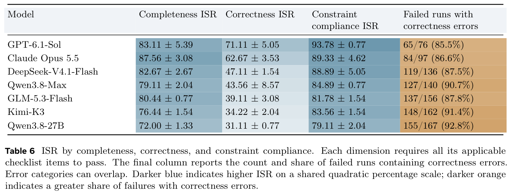 | 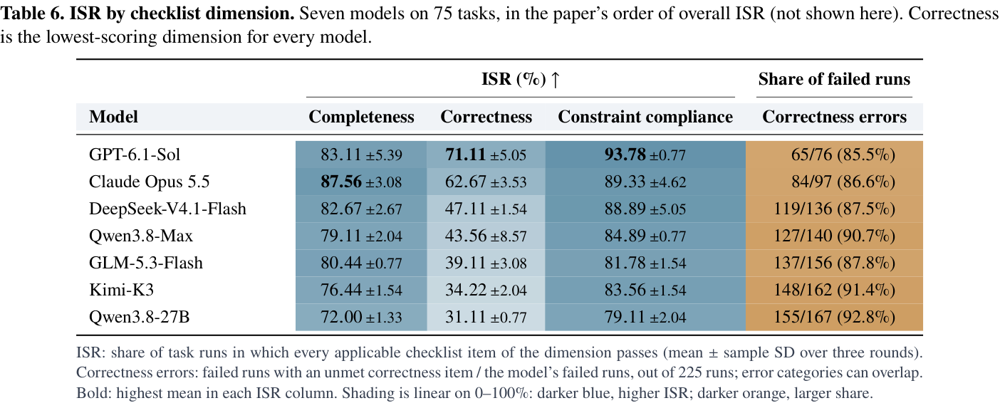 |

The heat map stays, now linear on a shared 0–100% scale named in the notes (the original is quadratic); bold marks the best mean per column, which the original leaves to the shades; SDs are set small; "ISR (%) ↑" becomes one spanner and "Share of failed runs" another, so every column name sits on one line; the shares are recomputed from the counts; the four-line caption becomes two sentences plus notes. [PDF](gallery/redesign/arebench_t6.pdf) · [spec](skills/cs-paper-table/assets/specs/redesigns/arebench_t6.json)

### Six more examples

Synthetic data; each table is designed from the skill's rules for its own reading task.

**Robustness.** The single-turn block is the unshaded reference; each multi-turn cell prints its raw score and is shaded by the points lost against the same model's single-turn score, so where the loss concentrates is seen before a digit is read. After *LLMs Get Lost in Multi-Turn Conversation* (ICLR 2026 outstanding paper), Table 1. [PDF](gallery/after/robustness.pdf) · [spec](skills/cs-paper-table/assets/specs/robustness.json)

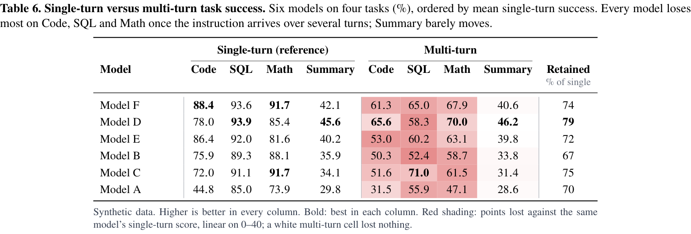

**Benchmark.** Two budgets as banner groups, baselines ordered by their average, the proposed method shaded and last in each, and under it a "Δ vs. Verifier" row: the margin over the strongest baseline, green for higher success and for lower cost alike. Directions sit in the spanners, n under each suite, and the caption states the margin in numbers. [PDF](gallery/after/benchmark.pdf) · [spec](skills/cs-paper-table/assets/specs/benchmark.json)

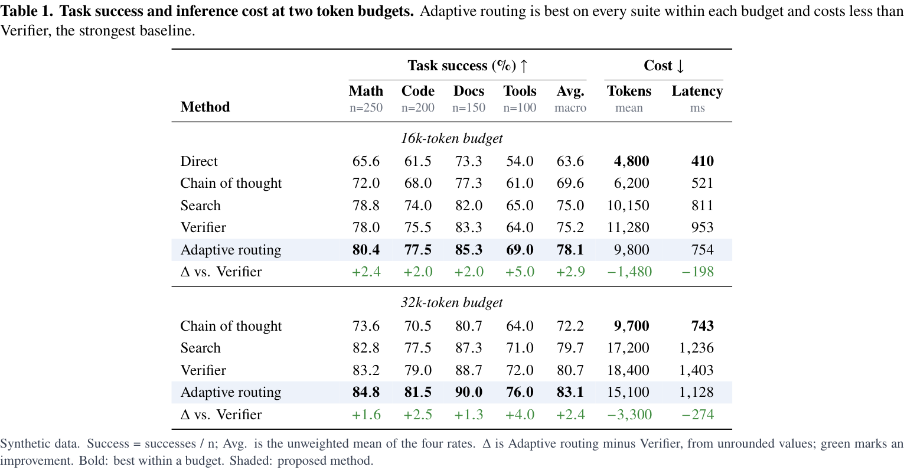

**Ablation.** The full system first as the shaded reference, removals ordered by their effect, and a change column beside each metric: the paired success difference with its 95% CI, and the latency difference, both coloured by improvement. The component with no detectable effect on success but 177 ms of latency is visible at once. [PDF](gallery/after/ablation.pdf) · [spec](skills/cs-paper-table/assets/specs/ablation.json)

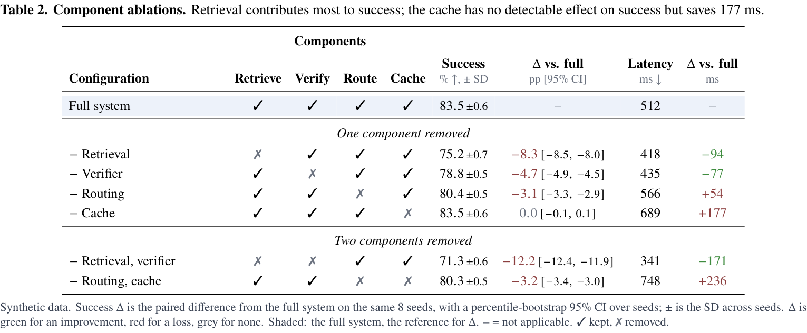

**Dataset register.** The unit sits right after the counts it qualifies, text is ragged right with no rules between records, and a genuine 0 stays distinct from NA and NR. [PDF](gallery/after/registry.pdf) · [spec](skills/cs-paper-table/assets/specs/registry.json)

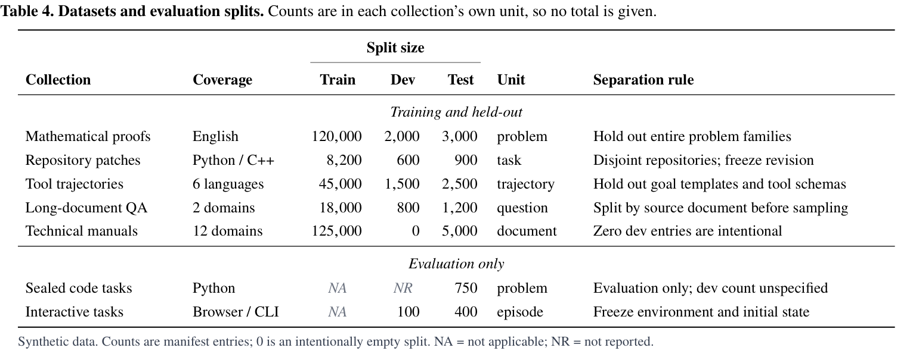

**Efficiency** and **single-column results**, both at 88 mm. Left: metrics as rows with a unit-and-direction column, grey bands for the three test conditions, bold within the matched 16k columns only, OOM as an outcome. Right: the caption states the finding and the protocol moves to the notes, ties share the bold, the external reference sits below its own rule with a † instead of a ranking. [PDF](gallery/after/efficiency.pdf) · [spec](skills/cs-paper-table/assets/specs/efficiency.json) · [PDF](gallery/after/budget_comparison.pdf) · [spec](skills/cs-paper-table/assets/specs/budget_comparison.json)

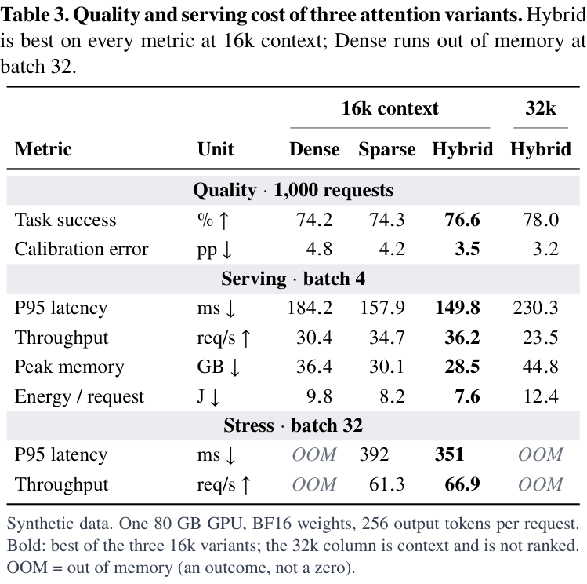 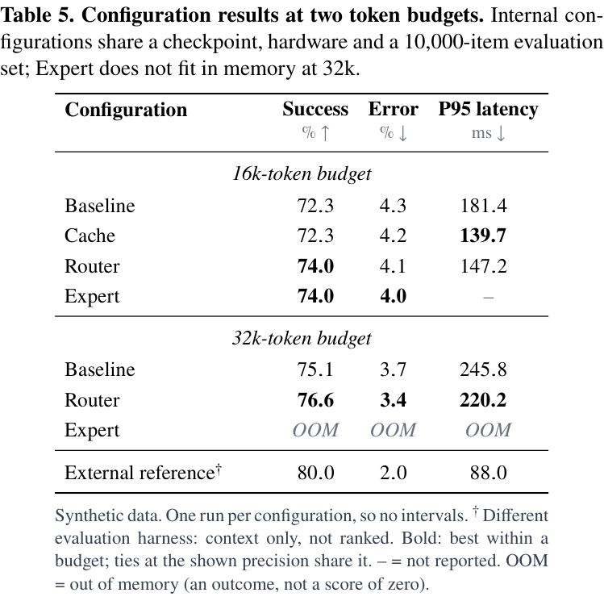

### Capability matrix

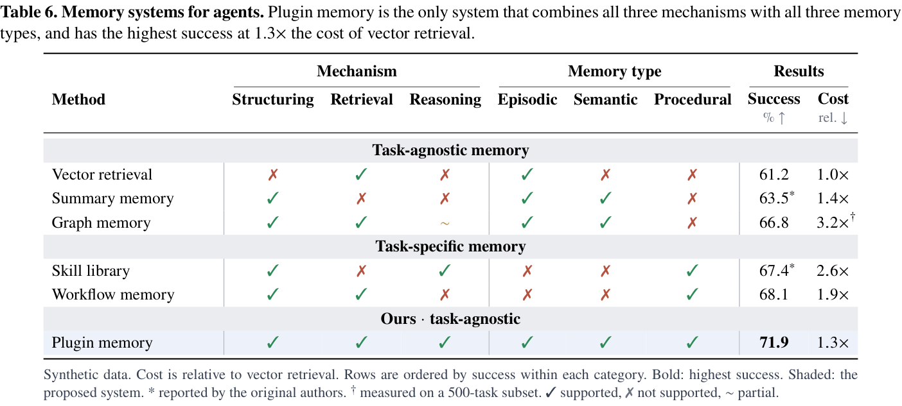

Column names in full words, so the notes need no glossary; grey category bands that carry what a "task-agnostic" column would only repeat; the proposed system marked once, by its band and tint; bold only where a ranking means something (success, not the cost of the reference itself); rows ordered by success within each category; hairlines only between column groups, coloured ✓/✗ with the glyph shape still distinct, `1.0×` relative cost, and `*` / `†` cell marks defined once in the notes. The caption states the finding. After the PlugMem and StudentSim tables (synthetic data). [PDF](gallery/after/capability.pdf) · [spec](skills/cs-paper-table/assets/specs/capability.json)

## Design rules in brief

1. **One table answers one question.** Put the compared numbers next to each other, down a column, in a stated order.
2. **The reader never computes.** Print the direction, unit, n, the reference and the margin.
3. **Space and alignment before ink.** Rules only at real boundaries; at most one vertical hairline, between what was set and what was measured.
4. **Emphasis is a budget.** One mark per meaning, each defined beside the table; a fill has one job per table.
5. **Secondary information recedes but stays readable.** Set ±, units and counts smaller or muted, never under the size floor.
6. **Comparability is visible.** Group comparable rows under a banner that names the condition or caveat; show missing, failed and censored results (`TO`, `> 180`) as values.
7. **Design at the final size, in the venue's template.** One table size per paper; recompose, never scale.
8. **One paper, one system.** Keep the same row order, precision, marks and hue meanings in every table.

Avoid: undefined bold or tints, a metric with no stated direction, "%" in every cell, `1354365` without separators, three-hue and traffic-light fills, the own row tinted pink, and 100-word captions that define each column.

The full rules, with the renderer field for each, are in [table-craft.md](skills/cs-paper-table/references/table-craft.md). They come from five visual studies of typeset PDFs: 13 AI-lab reports, five single papers, and 32 papers from 2025–2026 award lists (NeurIPS, ICML, ICLR; CVPR, ICCV, ACL, EMNLP; OSDI, SOSP, NSDI, USENIX Security, S&P, CCS, VLDB, SIGMOD, PLDI, CHI). The per-paper notes are in [craft-study.md](skills/cs-paper-table/references/craft-study.md).

## Installation

```bash
# 1. Skills CLI (Claude Code, Codex and other agents)
npx skills@latest add zichuanxu/cs-paper-table-skill

# 2. Claude Code plugin
claude plugin marketplace add zichuanxu/cs-paper-table-skill
claude plugin install cs-paper-table@cs-paper-table-skill

# 3. Codex plugin
codex plugin marketplace add zichuanxu/cs-paper-table-skill
codex plugin add cs-paper-table@cs-paper-table-skill
```

Or copy `skills/cs-paper-table` into `~/.claude/skills/`. The renderer needs Python ≥ 3.10 with `pymupdf` (and `numpy` for the example builder) and a TeX distribution with `pdflatex`, `newtx`, `booktabs`, `dcolumn`, `pifont` and `xcolor` (`wasysym` for ●/◐/○ matrices).

## Usage

Ask your agent in plain language, for example "Make the main results table from results.csv for a two-column paper", "Redesign Table 3 of this paper" or "Turn this ablation into a table with SDs and deltas".

To render the examples yourself:

```bash
cd skills/cs-paper-table/scripts
python render_table.py ../assets/specs/redesigns/harness2_t1.json --out /tmp/h2
python build_examples.py --out /tmp/examples --render
```

Each table comes out as `.tex`, `_body.tex` (drop into your `table` float), `_caption.tex`, PDF, PNG (216 dpi, 96 dpi and greyscale), HTML, CSV, the typed spec, an emphasis audit and automated checks.

## License

[MIT](LICENSE), except the original table crops in `gallery/redesign/original/`: the Transformer table is reproduced under Google's permission to reproduce tables and figures of *Attention Is All You Need* for scholarly works with attribution (Vaswani et al., NeurIPS 2017); the Harness² and PaperBanana tables are © their authors under [CC BY 4.0](https://creativecommons.org/licenses/by/4.0/); the ReHarness and ARE-bench tables are © their authors, reproduced for commentary and comparison and removed on request. The redesigns are independent demonstrations, not affiliated with those papers' authors.
